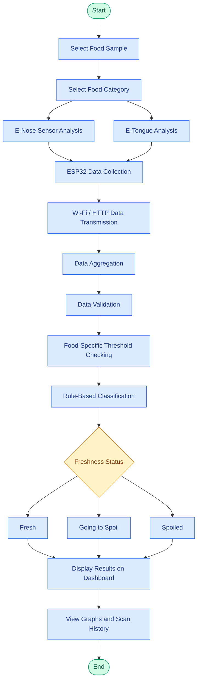

# 🥗 Fresh Guard – Smart Food Freshness Detection System

A smart food freshness monitoring system that combines Electronic Nose (E-Nose), Electronic Tongue (E-Tongue), ESP32 and a web-based dashboard to provide preliminary food freshness assessments.

## 🌐 Live Application

[**Visit Fresh Guard Website**](https://freshguardd.vercel.app/app)

## 📊 Project Presentation

[**View Fresh Guard Project PPT**](./Fresh_Guard.pptx)

## 📌 Project Overview

Fresh Guard aims to make preliminary food freshness monitoring easier and more accessible. Traditional freshness checking methods rely on visual inspection and smell, which can be subjective. Laboratory testing, although more reliable, may require specialised equipment, time and cost.

Our system combines sensor-based measurements with a software dashboard to analyse selected food samples and display freshness status.

## 🎯 Objectives

- Develop a low-cost preliminary food freshness monitoring system.
- Detect gas-related changes using E-Nose sensors.
- Measure pH and TDS values for suitable liquid food samples using E-Tongue sensors.
- Collect sensor data using ESP32.
- Transmit readings wirelessly to the software.
- Compare readings with predefined food-specific thresholds.
- Display freshness results and analysis through a dashboard.

## 🔄 System Flowchart

## 🧪 Freshness Classification

- 🟢 Fresh
- 🟡 Going to Spoil
- 🔴 Spoiled

The classification is based on predefined threshold values and rule-based logic.

## ✨ Key Features

- E-Nose-based gas monitoring.
- E-Tongue-based pH and TDS analysis for selected liquid samples.
- ESP32-based data collection.
- Wi-Fi and HTTP communication.
- Food-specific threshold comparison.
- Rule-based freshness classification.
- Interactive dashboard.
- Sensor reading visualisation.
- Scan history and weekly analysis.
- Storage precautions.

## 🛠️ Technologies Used

- ESP32
- E-Nose Sensors
- E-Tongue Sensors
- pH Sensor
- TDS Sensor
- Wi-Fi Communication
- HTTP Data Transmission
- Web-Based Dashboard
- Rule-Based Classification

## 🌍 Applications

- Preliminary food freshness monitoring.
- Household food quality awareness.
- Food storage monitoring.
- Educational and research applications.
- Food handling and quality assessment support.

## ⚠️ Note

Fresh Guard provides a preliminary freshness assessment based on sensor readings and predefined thresholds. It is not a certified food safety testing system and should not replace laboratory testing or established food safety practices. Sensor calibration and experimental validation are necessary for reliable results.

## 👩‍💻 Project Team

**Harini S.**  
Electronics and Communication Engineering

---

⭐ If you find this project interesting, feel free to explore the live application and presentation!
